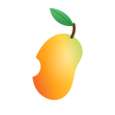
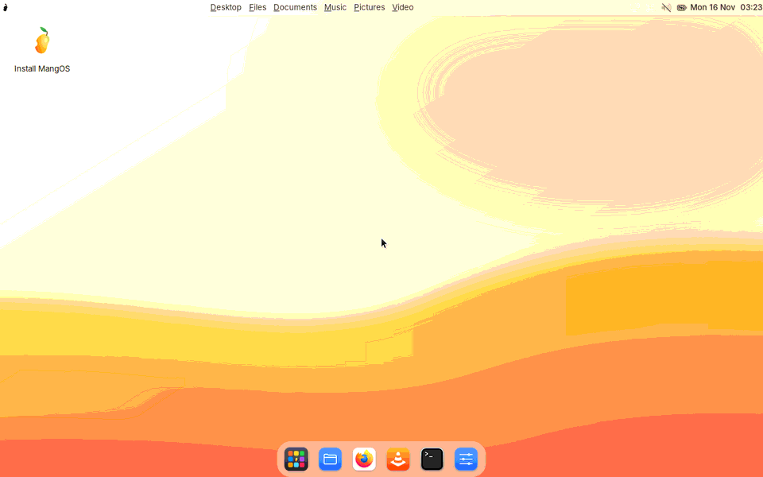
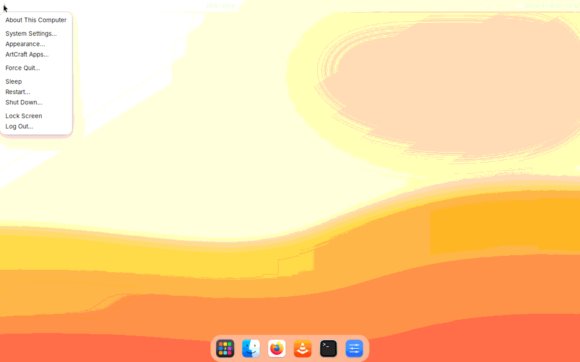
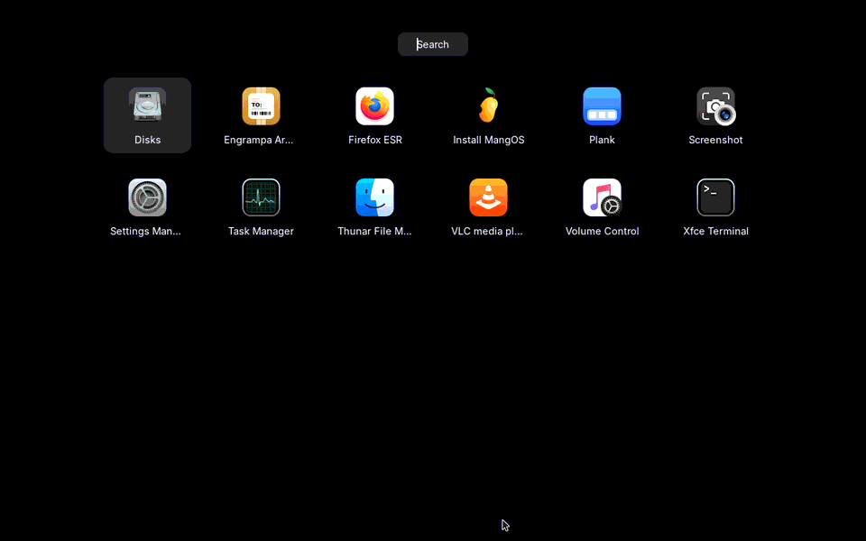
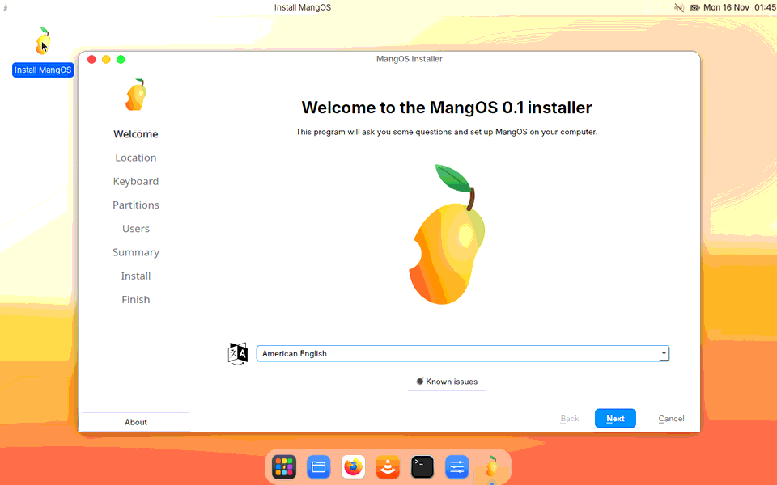

<p align="center"></p>

# MangOS

A Debian 13 (trixie) based system that looks and feels as close as possible
to macOS, built to give a 2007 polycarbonate MacBook (A1181, Core 2 Duo,
4 GB RAM) a second life. Light enough for old Intel graphics, with the
ArtCraft creative apps preinstalled.

| | |
|---|---|
| Base | Debian 13 stable, amd64, live-build |
| Desktop | XFCE 4.20 + Plank dock, WhiteSur theme (light/dark), Inter font |
| Top bar | MangOS logo menu, global app menu, tray, sound, battery, clock |
| Launchpad | full-screen app grid with search (rofi): dock icon, Cmd+Space or F4 |
| Keyboard | Command key works like on a Mac (keyd): Cmd+C/V/X/Z/Q/W/Tab/Space |
| Trackpad | tap to click, natural scrolling, two-finger right click |
| Wi-Fi | Broadcom BCM4321 (MacBook3,1): `wl` driver prebuilt with DKMS (offline); `b43` + firmware as reserve; *Wi-Fi Check* tool |
| Apps | ArtCraft launcher, WordCraft, PdfCraft, PhotoCraft, Firefox ESR, VLC |
| Store | MangOS Store: 2,000+ Debian apps from the AppStream catalog, Mac-style layout, Get/Open, updates |
| Installer | Calamares with a macOS-installer style theme; BIOS, EFI64 and **EFI32** |
| Languages | English default, Italian included; more from *Settings > Language* |

## Screenshots (from VM tests)

| | |
|---|---|
|  |  |
|  |  |

## Updates

Installed systems update themselves from the web: every build publishes a
signed `mangos-system` package and MangOS installs new versions on its own.
See [`docs/UPDATES.md`](docs/UPDATES.md) (includes the one-time GitHub setup).

## Build

On Debian 13:
```sh
sudo apt install live-build debootstrap dctrl-tools apt-utils xorriso git curl rsync librsvg2-bin imagemagick \
  gtk-update-icon-cache b43-fwcutter bzip2 sassc libglib2.0-dev-bin libxml2-utils sudo \
  grub-efi-amd64-bin grub-efi-ia32-bin grub-efi-amd64-signed shim-signed grub-pc-bin \
  syslinux isolinux syslinux-efi mtools dosfstools squashfs-tools
sudo ./build.sh
```
On any other Linux distribution, `sudo scripts/buildenv.sh build` creates a
Debian build chroot and runs the same script inside it.

The result is `out/MangOS-<version>-amd64.iso` plus a `.sha256` file.
All upstream sources are pinned in [`scripts/versions.env`](scripts/versions.env).

Useful variables: `MANGOS_SKIP_ARTCRAFT=1`, `MANGOS_REQUIRE_ARTCRAFT=1`,
`MANGOS_APT_PROXY=http://…`, `MANGOS_BUILD_CA=/path/ca.crt` (see `build.sh`).

## Test

Always test in a VM before using a USB stick on the Mac:
```sh
scripts/test-vm.sh uefi32   # 32-bit EFI, like the MacBook (needs ovmf-ia32)
scripts/test-vm.sh bios     # legacy BIOS path
scripts/test-vm.sh install  # 64-bit UEFI with an empty disk, to try the installer
```
Results of each test are recorded in [`docs/TESTING.md`](docs/TESTING.md).

## Write to USB and install

See [`docs/INSTALL-USB.md`](docs/INSTALL-USB.md). Known problems are listed in
[`docs/KNOWN-ISSUES.md`](docs/KNOWN-ISSUES.md).

## Repository layout

```
build.sh                      the one build script
auto/config                   live-build options
config/package-lists/         packages in the image
config/hooks/live/            build-time setup (identity, desktop, ArtCraft, GRUB, boot)
config/includes.chroot/       files copied into the system
  etc/calamares/              installer settings + MangOS branding (QSS, slideshow)
  etc/keyd/, etc/X11/         Mac keyboard and trackpad behaviour
  etc/dconf/, usr/share/mangos/xfconf/   desktop, dock and top-bar defaults
  usr/bin/mangos-*            About, Welcome, Appearance, Language, Launchpad
  usr/share/plymouth/themes/mangos/      boot splash
branding/logo/                logo source (SVG) and generator for all sizes
scripts/                      build environment, themes, ArtCraft, wallpapers, VM tests
docs/                         USB/installation guide, tests, known issues
```

## Credits and licences

- MangOS logo, wallpapers and scripts: original work for this project.
- [WhiteSur](https://github.com/vinceliuice) GTK, icon and cursor themes by
  Vince Liuice (GPL-3.0 / MIT), built from pinned sources at build time.
- [ArtCraft](https://github.com/storytold) apps by storytold, downloaded from
  their official releases and verified against `SHA256SUMS.txt`.
- [Inter](https://rsms.me/inter/) font (OFL), from Debian.

MangOS is not affiliated with Apple. macOS is a trademark of Apple Inc.
